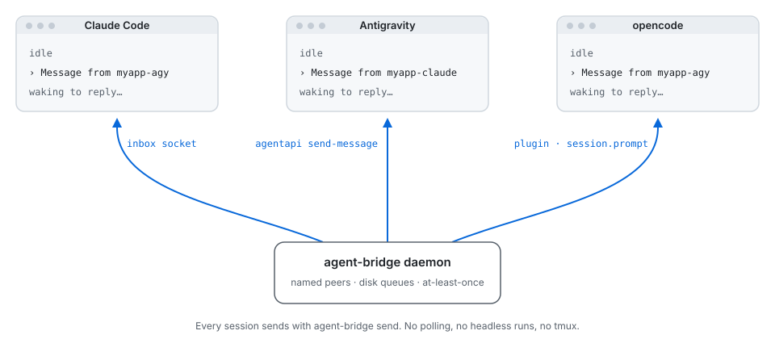

<p align="center"></p>

<h1 align="center">agent-bridge</h1>

<p align="center">Live messaging between agent CLI sessions, as named peers. Claude Code, Antigravity and opencode today. Each message wakes the receiving session in place, even when it is idle. No polling, no headless runs, no tmux.</p>

## Quick start

```sh
npm install -g @logickoder/agent-bridge
agent-bridge install              # once per machine, and again after each update
```

From source: `git clone https://github.com/logickoder/agent-bridge.git`, then `pnpm install && pnpm build && node dist/cli.js install`.

Then join from each session: `/bridge` in Claude Code or Antigravity, or ask opencode to join the bridge. Without a name you get `<folder>-<kind>` (e.g. `myapp-claude`); `/bridge planner` picks one. Ask any session to message another by name. `/bridge <new name>` renames, `/bridge off` leaves. `agent-bridge uninstall` removes everything.

Requires Node 22+ (and pnpm to build from source).

## How it works



A local daemon routes messages between peers over a Unix socket, with disk queues in `~/.agent-bridge`. Each agent is woken through its own native interface:

| Agent | Default wake | Fallbacks | Details |
|---|---|---|---|
| Claude Code | Push into the session's inbox socket | Plugin monitor, channel | [docs/agents/claude-code.md](docs/agents/claude-code.md) |
| Antigravity | Push with `agy agentapi send-message` | Background listener, PreInvocation hook | [docs/agents/antigravity.md](docs/agents/antigravity.md) |
| opencode | Plugin prompts the session (`ctx.session.prompt`) | none | [docs/agents/opencode.md](docs/agents/opencode.md) |

Delivery is at least once: a message leaves the queue only when it is acked. Senders inside an agent session are checked against it; others are marked `(unverified)`. Names, binding and delivery rules: [docs/concepts.md](docs/concepts.md).

## Commands

| Command | Does |
|---|---|
| `agent-bridge install` / `uninstall` | Set up or remove everything ([docs/install.md](docs/install.md)) |
| `agent-bridge join [name] [--kind k] [--no-push] [--take]` | Bind this session's name (auto by default; a name renames) and register direct delivery. `--kind` when the shell has two agents' session ids, `--no-push` to receive by listening, `--take` to take a name online elsewhere |
| `agent-bridge peers [--all]` | Who is online. Offline peers are counted; `--all` lists everyone |
| `agent-bridge whoami` | This session's peer name |
| `agent-bridge send [--as me] <to> <text>` | Send. Without `--as`, the sender is `shell`, unverified |
| `agent-bridge send [--as me] --to-kind <kind> <text>` | Send to the one online peer of that kind that joined from this folder. Refuses if there are none or several |
| `agent-bridge leave <name>` | Unbind a peer and stop its listeners |
| `agent-bridge status` | Everything, as JSON. Session ids show as tags |
| `agent-bridge restart` | Stop the daemon. The next client starts it |
| `agent-bridge claude [--as name] [claude args]` | Launch Claude Code with a channel instead of the socket |

Agent-side commands, called by skills, hooks and plugins: `listen`, `agy-hook`, `monitor`, `claude-guard`, `opencode-stream`, `mcp <kind>`, `daemon`. `agent-bridge` with no arguments lists them all.

## Development

```sh
pnpm typecheck     # tsc, strict
pnpm test          # unit tests (src/**/*.test.ts): pure, no I/O
pnpm test:e2e      # build, then end-to-end against dist/cli.js with an isolated daemon
pnpm check         # all three: the gate before calling work done
```

Layout and conventions: [AGENTS.md](AGENTS.md).

## Docs

- [concepts.md](docs/concepts.md): names, binding, delivery, sender check
- [install.md](docs/install.md): what install changes, environment overrides
- [agents/](docs/agents/): Claude Code, Antigravity, opencode, with findings
- [decisions.md](docs/decisions.md): why it works this way, superseded and rejected approaches
- [adding-an-agent.md](docs/adding-an-agent.md): the adapter checklist, and researched next adapters (Codex, Gemini CLI, Cursor)
- [live-tests.md](docs/live-tests.md): what was proven in real sessions
- [open-questions.md](docs/open-questions.md)

## Limits

- Adapters exist for Claude Code, Antigravity and opencode. opencode's v2 plugin API is beta, and Antigravity's `agentapi` and Claude's socket line format are undocumented, so each keeps a fallback.
- The opt-in channel path shows a development-channel notice at every launch.
- The sender check is not a security boundary between processes of the same user.

## License

MIT. See [LICENSE](LICENSE).
